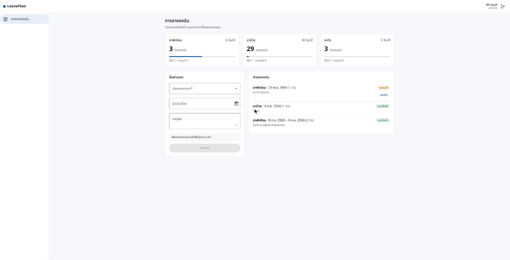
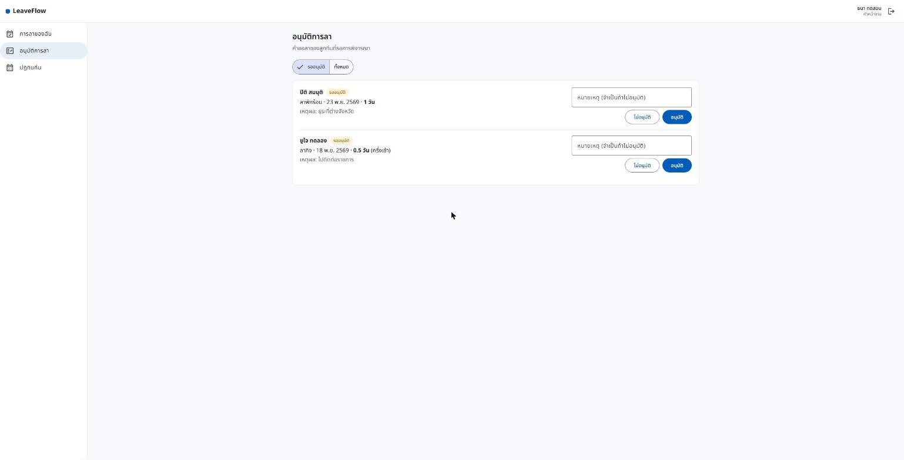
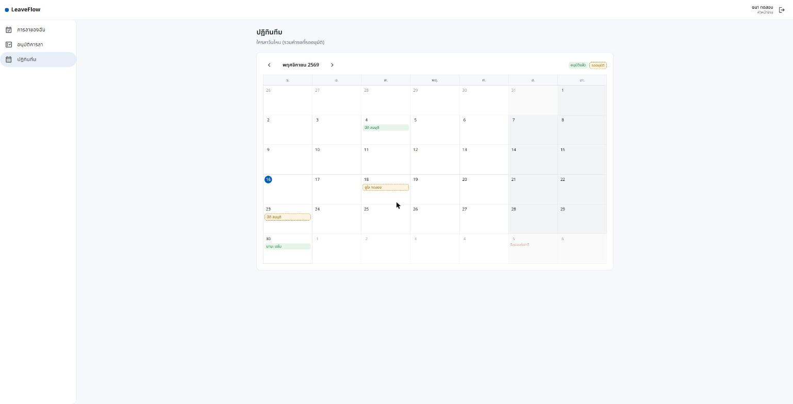
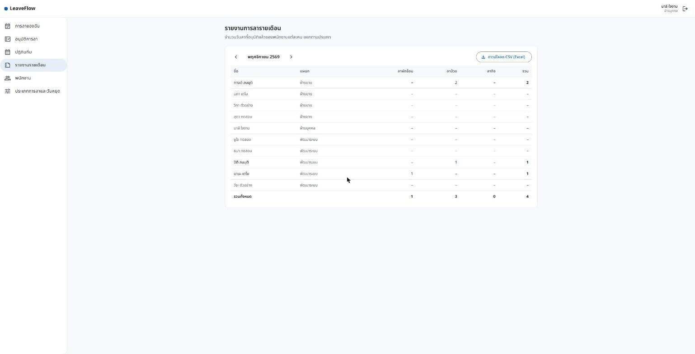

# LeaveFlow

[](https://github.com/bunjonglak123/leaveflow/actions/workflows/ci.yml)

Leave request and approval system for small and medium businesses (Thai UI).
Employees request leave, managers approve it, HR manages policies and gets a monthly report.

**Live demo:** https://leaveflow-demo-sbwh.onrender.com — one-click login as employee, manager or HR. Fake data, reset every day. Free hosting sleeps when idle, so the first load can take ~30 seconds.

**Stack:** ASP.NET Core 10 Web API · EF Core 10 · SQL Server 2022 · Angular 22 + Angular Material · xUnit · Vitest · Docker · GitHub Actions

| Employee | Manager approvals |
|---|---|
|  |  |
| **Team calendar** | **HR monthly report** |
|  |  |

All names and data in the screenshots and demo are made up.

## Features

- **Employee:** leave balances per type, request full day or half day (morning/afternoon) with a live working-day count, cancel while pending, status history.
- **Manager:** approval queue for direct reports, approve/reject with a note (required when rejecting), team month calendar.
- **HR admin:** employees with department, role and approving manager; leave types with yearly quota; company holidays; monthly report per employee × leave type with **CSV export that opens correctly in Excel** (UTF-8 BOM, formula-injection safe).
- **Rules (in `LeaveFlow.Domain`, fully unit tested):**
  - working days skip weekends and company holidays; half day = 0.5 and only on a single date
  - balance check counts approved **and** pending requests, so two pending requests can't overspend
  - no overlapping requests (a morning and an afternoon half day on the same date are fine)
  - nobody approves their own request; managers only decide for their direct reports
  - a request must stay within one calendar year
  - every status change is written to an audit log
  - a sole HR admin with no manager is auto-approved (with an audit note) instead of waiting forever
- **Thai labour-law defaults** seeded: ลาพักร้อน 6, ลาป่วย 30, ลากิจ 3 days/year, plus fixed-date Thai public holidays.

## Architecture

```
web/                    Angular SPA (standalone components, signals, lazy routes, role guards)
src/LeaveFlow.Domain    entities + business rules, no framework dependencies
src/LeaveFlow.Api       controllers, EF Core (SQL Server migrations / SQLite), JWT auth, demo seed & daily reset
tests/                  xUnit: domain rules + API integration tests (WebApplicationFactory)
```

- One Docker image: the Angular build is served from the API's `wwwroot`.
- `Database:Provider` switches between **SQL Server** (default, EF migrations) and **SQLite** (free demo hosting).
- JWT bearer auth with role policies (`Employee`, `Manager`, `HrAdmin`). The token clock and validation share one injectable `TimeProvider`, so tests run on a fixed date.

## Run it

**Everything in Docker (SQL Server + app):**

```bash
docker compose --profile app up --build
# open http://localhost:8080 and use the demo buttons
```

**Development:**

```bash
docker compose up -d sqlserver                     # database only
dotnet run --project src/LeaveFlow.Api --launch-profile http   # API on :5071, migrates + seeds
cd web && npm ci && npx ng serve                   # UI on :4200, proxies /api to :5071
```

Demo accounts (password `demo1234`): `employee@leaveflow.demo`, `manager@leaveflow.demo`, `hr@leaveflow.demo`.

**Public demo image** (SQLite, fake data, reset every day):

```bash
docker build -t leaveflow . && docker run -p 8080:8080 leaveflow
```

## Tests

```bash
dotnet test                                    # 29 domain + 52 API tests (SQLite)
LEAVEFLOW_TEST_SQLSERVER="Server=localhost,1433;User Id=sa;Password=LeaveFlow_dev_123!;TrustServerCertificate=True" \
  dotnet test tests/LeaveFlow.Api.Tests        # same API tests on real SQL Server via migrations
cd web && npx ng test --watch=false            # Angular unit tests
node scripts/smoke.mjs http://localhost:8080   # end-to-end smoke against a running app
```

CI (GitHub Actions) runs all of the above, including the SQL Server pass and a smoke test of the built image.

## Configuration

| Key | Meaning |
|---|---|
| `Database:Provider` | `SqlServer` (default) or `Sqlite` |
| `ConnectionStrings:Default` | database connection string |
| `Jwt:Key` | signing key, ≥ 32 characters. **Required** outside demo mode |
| `Seed:Enabled` | seed the fake demo organisation on an empty database |
| `Demo:Enabled` | enables one-click demo login; generates a random JWT key if none is set |
| `Demo:ResetDaily` | wipe and reseed the demo data once per local day |

Set them as environment variables with `__` (e.g. `Jwt__Key`). Never commit real keys or passwords; the ones in `appsettings.Development.json` and `docker-compose.yml` are local-only defaults.
